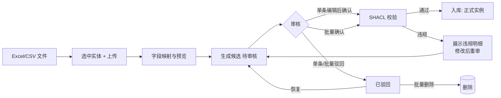
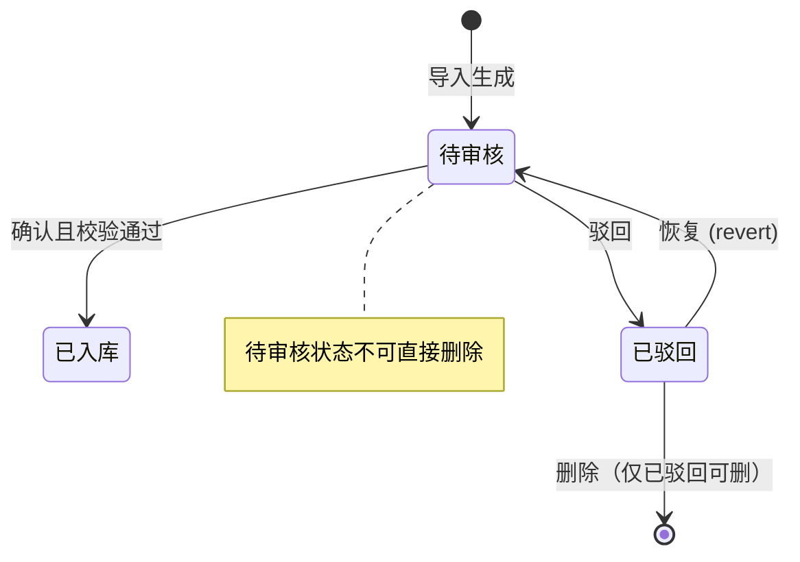

# 业务人员使用流程说明

> 适用对象：公司业务人员（无需编程基础）
> 平台地址：前端 http://<服务器>:8123 ｜ 后端 API http://<服务器>:8000（文档 /docs）
> 依据：调研材料 oswalpalash/ontology skill 分析 + 当前平台实际功能（8 个功能页）

---

## 1. 调研 skill 简析：oswalpalash/ontology

### 1.1 它是什么

一个面向 **AI 编码智能体**的 Agent Skill（v1.0.4），把"类型化词汇表 + 约束校验"做成了 AI 的结构化记忆与跨技能共享状态：

| 文件 | 作用 |
|---|---|
| `SKILL.md` | 写给 AI 看的说明书（触发词 + 工作流 + 约束示例） |
| `scripts/ontology.py` | CLI 工具：create / get / query / list / update / delete / relate / related / validate / schema-append |
| `references/schema.md` | 16 类实体词表（Person/Project/Task/Event/Document/Credential…）+ 关系类型 + 全局约束 |
| `references/queries.md` | 查询与图遍历示例 |

### 1.2 从使用方式上看：它是给 AI 用的，不是给人用的

- **使用者是 AI 智能体**：skill 安装进 AI IDE 后，用户在对话框里说"记住…""X 和 Y 什么关系""谁依赖 X"，AI 读 SKILL.md 自动执行 `python scripts/ontology.py ...` 命令。
- **数据存储在本机文件**：`memory/ontology/graph.jsonl`（**只追加**的操作日志：create/update/delete/relate，当前状态 = 日志重放折叠）+ `memory/ontology/schema.yaml`（约束，只合并追加、不覆盖）。
- **每次写入前做约束校验**：必填属性、枚举值、关系端点类型、基数（1:1/1:N/N:1）、无环（blocks/depends_on）、Event 结束时间 ≥ 开始时间。
- **无服务、无界面、无多用户、无鉴权**——它解决的是"单个 AI 的记忆与状态共享"，不是"业务团队协作"。

**结论：业务人员无法直接使用这个 skill。** 但它验证了本体平台的核心设计（类型化词表 + 提交前校验 + 追加式审计），当前项目正是把这些设计产品化为 Web 平台，让业务人员"看得见、点得动、查得清"。

### 1.3 skill 概念与当前平台对照

| skill 概念 | 当前平台实现 |
|---|---|
| 类型化词表（type/properties） | 建模页：对象类型 + 业务属性（业务名称/类型/必填） |
| Relations（from/rel/to + 基数 + 无环） | 建模页：对象关系（N:1 等，目标对象自动联想） |
| validate（提交前约束校验） | 业务校验门 + SHACL 校验，失败返回逐条明细（details.violations） |
| graph.jsonl 只追加操作日志 | 实例 JSONL 存储 + 日志页全量审计 |
| schema-append（合并不覆盖） | 本体保存走完整校验，修改全程留痕 |
| Agent CLI（create/query/relate…） | REST API + MCP 工具（/mcp/{项目id}），AI 助手可直接接入 |
| Credential 禁止明文存密 | 平台暂无对应项，建议后续安全规范借鉴 |
| 单机单用户 | Web UI + 项目空间隔离 + 多用户 |

---

## 2. 当前平台使用总览

### 2.1 角色与入口

| 角色 | 入口 | 典型工作 |
|---|---|---|
| 业务人员 | 浏览器打开前端页面 | 建模、导入业务数据、审核候选、查询与影响分析 |
| 业务负责人/管理员 | 同上前端 + MCP 页 | 审核把关、发布本体供 AI/外部系统使用 |
| AI 智能体/外部系统 | `/mcp/{项目id}` 或 REST API | 读取已发布本体与实例、执行查询工具 |

平台共 8 个功能页（顶部导航）：**建模、实例导入、图谱、推理、业务动作、MCP、日志、设置**。

### 2.2 使用总流程图

```mermaid
flowchart TD
    Start([业务人员打开平台]) --> P[顶部选择项目空间]
    P --> Has{该业务域已有本体?}

    Has -- 没有 --> M1[建模页: 新建本体]
    M1 --> M2{建模方式}
    M2 -- 自然语言描述业务场景 --> M3[AI 自动生成草稿]
    M2 -- 手动建模 --> M4[定义对象类型 → 属性 → 关系]
    M3 --> M4
    M4 --> M5[保存]
    M5 --> M6{业务校验门}
    M6 -- 未通过 --> M7[查看逐条失败明细并修改] --> M4
    M6 -- 通过 --> IMP

    Has -- 已有 --> IMP[实例导入页: 选中目标实体]
    IMP --> IMP1[上传 Excel / CSV 业务数据]
    IMP1 --> IMP2[字段映射: 表格列 → 属性 / 关系字段]
    IMP2 --> IMP3{预览校验}
    IMP3 -- 字段不匹配 --> IMP2
    IMP3 -- 通过 --> CAND[生成候选实例<br/>状态: 待审核]

    CAND --> REV[候选表格审核<br/>逐条 编辑/确认/删除 + 批量 确认/驳回]
    REV --> AP{确认结果}
    AP -- 校验通过 --> OK[实例正式入库 ✅<br/>实体列表 / 图谱可见]
    AP -- 违规 --> FIX[查看违规明细, 修改候选] --> REV
    REV --> RJ[驳回 → 可恢复 或 批量删除]
    RJ -. 恢复 .-> REV

    OK --> USE[日常使用]
    USE --> U1[实例列表直查 / 图谱浏览]
    USE --> U2[自然语言查询<br/>AI 生成 SPARQL 并执行]
    USE --> U3{需要评估变动影响?}
    U3 -- 需要 --> INF[推理页: 模拟实例值变动<br/>如 某审批 +3 天]
    INF --> INF2[影响推理<br/>R1 直接引用回溯 + R2 时间链传导]
    INF2 --> INF3[输出受影响实例 + 推理依据 + 置信度<br/>标注: 需人工确认]
    U3 -- 不需要 --> SH[共享与集成]
    INF3 --> SH
    SH --> SH1[MCP 页: 按本体清单逐项发布/取消]
    SH1 --> SH2[AI 助手 / 外部系统<br/>经 /mcp/{项目id} 接入]
    SH2 --> LOG[日志页: 全操作审计]
```

### 2.3 核心子流程：实例导入与候选审核

业务数据**不是直接入库**，而是"导入 → 候选 → 审核 → 入库"，保证每一条数据都经过人工把关：



候选实例状态机：



---

## 3. 分页面操作指引

### 3.1 建模页（建"数据字典"）

**做什么**：定义业务域里有哪些对象、每个对象有哪些属性、对象之间什么关系。

1. 点「+ 新建」创建本体（或用"自然语言描述业务场景"让 AI 生成草稿，再人工调整）；
2. 定义**对象类型**（如 采购订单、计划节点），给业务名称与业务定义；
3. 配置**属性**（业务名称、数据类型、是否必填）；指定主键（stable_key，如"订单编号"，业务上唯一）；
4. 配置**关系**（如 计划节点 属于 采购订单，N:1）——目标对象输入有**自动联想**，选即可；
5. 保存。校验不通过时，页面会**逐条列出**具体哪条规则失败，按提示修改后再存。

**注意**：建模是后续一切的前提；关系字段（如"所属订单"）在导入数据时可以填**业务编号**（目标实例的主键值），不需要填系统 ID。

### 3.2 实例导入页（业务数据进平台）

**做什么**：把 Excel/CSV 里的业务数据变成平台里的实例。

1. 左侧实体树**选中目标实体**（按从属关系分层展开，信息精简）；
2. 点导入，上传 Excel/CSV（单文件、带表头；多 sheet 文件会按 sheet 分别生成候选）；
3. **字段映射**：把表格列对应到对象的属性或关系字段（关系字段可直接映射，填目标实例的业务编号即可）；
4. **预览**：系统先做一轮校验，映射错误当场可见；
5. 生成**候选列表**（表格展示，非代码）：
   - 每条有独立「编辑 / 确认 / 删除」按钮 + 前置复选框；
   - 可**批量确认入库**或**批量驳回**；
   - 已驳回条目可**恢复**回待审核，也可**批量删除**（待审核条目不允许直接删除，必须先驳回）。
6. 确认时再过一道 SHACL 校验：通过即入库，违规会明确提示违例字段。

导入完成后，选中该实体即可在右侧**直接看到全部实例列表**（无需再点击）。

### 3.3 图谱页（看图、问数）

- **图谱可视化**：对象与实例的关系网络，点选实体查看邻居；
- **自然语言查询**：输入框直接问业务问题（如"有多少个客户创建了订单？"），AI 自动生成 SPARQL 并执行，返回结果（可展开查看生成的 SPARQL 以便核对）。

### 3.4 推理页（变动影响推演）

**做什么**：回答"如果某个业务值变了，会波及哪些后续事项"。

1. 选择一个目标实例与要变动的属性（如 采购订单的"审批日期" +3 天）；
2. 提交后系统执行**确定性推理**：
   - **R1 直接引用回溯**：找出所有引用该实例的业务对象；
   - **R2 时间链传导**：沿时间属性推算下游节点的顺延；
3. 结果给出**受影响实例 + 推理依据 + 置信度**，并明确标注"**需人工确认**"——系统只推演、不替人做决定。

### 3.5 业务动作页（仅展示）

页面顶部有"**仅作展示，暂未开发**"标记：此处的动作模板与日志用于展示规划，**不会回写任何业务系统**（避免风险），可安全浏览。

### 3.6 MCP 页（让 AI 用你的本体）

- 已发布本体以**清单**形式展示，每一项可**独立发布 / 取消发布**；
- 接入端点规则：`/mcp/{项目id}`——**按项目区分**（同一项目下所有已发布本体共享一个端点，不同项目各一个端点），不是每个本体一个端口；
- 发布后，支持 MCP 的 AI 助手/外部系统即可把该项目的本体与实例当作工具上下文使用。

### 3.7 日志页（审计）

谁、什么时间、对什么对象、做了什么操作（导入、审核、发布、编辑…）全程留痕，供追溯与合规检查。

### 3.8 设置页

项目空间管理、依赖服务状态（Jena/Neo4j/Postgres 不可用时平台自动降级为文件存储，功能不受影响，右上角健康指示灯可见）。

---

## 4. 常见场景速查

| 业务场景 | 操作路径 |
|---|---|
| 新业务域第一次上平台 | 建模页新建（可 AI 草稿）→ 定义对象/属性/关系 → 保存过校验 |
| 把年度计划表（Excel）录入平台 | 实例导入页 → 选中实体 → 上传 → 字段映射 → 预览 → 候选审核 → 批量确认 |
| 发现某条导入数据错了 | 候选里编辑后重审；已入库数据在实例列表/建模数据中修正后重新提交 |
| "这个审批晚了 3 天，影响哪些计划节点？" | 推理页 → 选订单实例 + 审批日期 +3 天 → 查看受影响清单（人工确认） |
| 快速统计/查询业务数据 | 图谱页自然语言查询框直接提问 |
| 让公司 AI 助手认识这套业务本体 | MCP 页逐项发布 → 提供 `/mcp/{项目id}` 给 AI 侧配置 |
| 审计"谁改过 / 何时发布" | 日志页按时间/操作类型筛选 |

---

## 5. 使用注意事项

1. **数据先审后用**：任何导入都走候选审核，不确认绝不入库——这是平台的数据质量底线。
2. **主键要业务化**：建对象时 stable_key 选业务编号（订单号/节点编号），导入填编号即可，跨文件引用也能自动关联。
3. **推理结果需人工确认**：影响推演是启发式+规则传导，给出的是"候选影响清单"，决策权在业务人员。
4. **业务动作不回写**：当前版本动作页仅展示，不触碰业务系统，可放心演示。
5. **多项目隔离**：不同业务域放不同项目空间，数据互不可见，MCP 端点也按项目隔离。
6. **调研 skill 的借鉴**：oswalpalash/ontology 的"只追加日志、schema 只合并不覆盖、密钥禁止明文"三条设计值得纳入平台后续规范。
