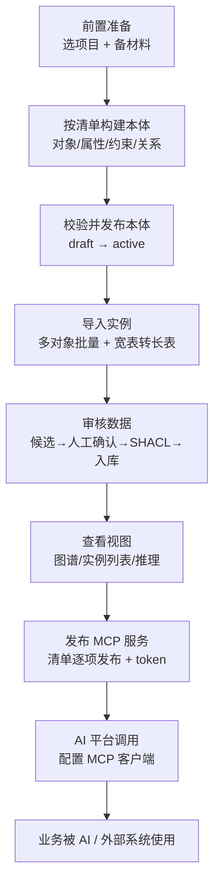
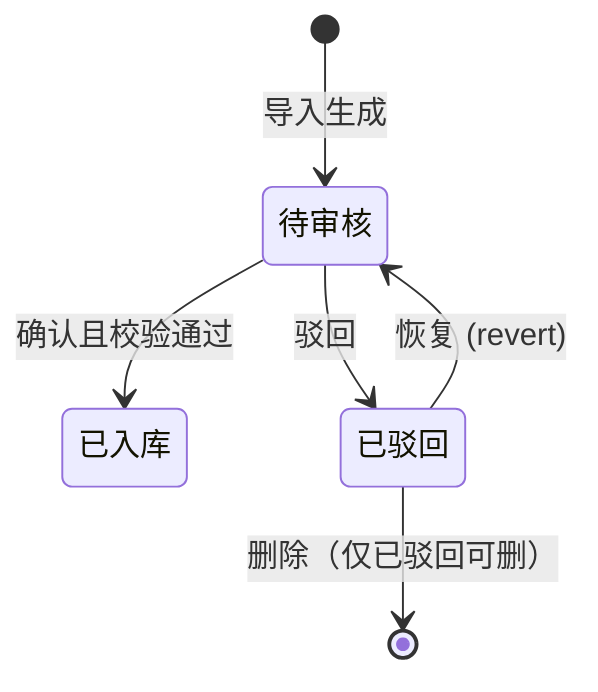

# 本体平台使用教程 · 从建模到 MCP 调用（端到端闭环）

> 适用对象：业务人员 / 本体使用者（无需编程基础）
> 平台：前端 http://<服务器>:8123 ｜ 后端 API http://<服务器>:8000
> 贯穿案例：**维保服务产品成本模型**（17 个对象 / 86 属性 / 2 关系 / 17 条唯一约束 / 2277 条实例）
> 说明：本教程把「按本体清单构建本体 → 设约束、关系 → 导入实例 → 审核数据 → 查看视图 → 发布 MCP 服务 → 在 AI 平台调用」的**完整闭环**串成一条可照做的操作主线。文中所有例子均来自本平台真实跑通的案例。

---

## 目录

- [〇、整体流程总览](#整体流程总览)
- [一、前置准备：选项目空间与准备材料](#前置准备)
- [二、按本体清单构建本体（对象 → 属性 → 约束 → 关系）](#按本体清单构建本体)
- [三、设置约束与关系（字段规则详解）](#设置约束与关系)
- [四、校验并发布本体（draft → active）](#校验并发布本体)
- [五、导入实例（多对象批量导入 + 宽表转长表）](#导入实例)
- [六、审核数据（候选 → 人工确认 → SHACL → 入库）](#审核数据)
- [七、查看视图（图谱三视图 / 实例列表 / 推理）](#查看视图)
- [八、发布 MCP 服务（清单逐项发布 + 生成 token）](#发布-mcp-服务)
- [九、在 AI 平台调用（WorkBuddy 接入示例）](#在-ai-平台调用)
- [附录 A：字段规则速查](#附录-afield-quick-ref)
- [附录 B：宽表转长表判断口诀](#附录-bwide-to-long)
- [附录 C：常见坑与排查](#附录-ctroubleshooting)

---

<a name="整体流程总览"></a>
## 〇、整体流程总览

平台把「你的业务」变成**一份可管理、可查询、可推演、可开放给 AI 的资产**。主线共 7 步：



**两条铁律贯穿始终：**

1. **数据先审后用**：任何实例都必须走「候选 → 人工确认 → SHACL → 入库」，**不确认绝不入库**。
2. **发布后才可见**：本体默认 `draft`，**发布（published / active）后**才会写入推理引擎并可被 MCP / 图谱消费。

> 用途提示：先按清单把骨架（对象/属性/约束/关系）建好并发布，再导数据。**不用等所有表都建完**——只要目标对象的 ID 已填进表单，就能立刻给源对象配关系（目标对象输入框带自动联想）。

---

<a name="前置准备"></a>
## 一、前置准备：选项目空间与准备材料

### 1.1 选/建项目空间

- 平台所有数据按 `?project_id=` **多项目隔离**：不同业务域放不同项目空间，数据互不可见，MCP 端点也按项目隔离。
- 顶部导航栏选择**项目名 / 部门空间**，确保后续所有操作都在正确的项目下进行。

### 1.2 准备材料（本体清单 + 业务数据）

建模前先有**两份材料**：

| 材料 | 作用 | 本例来源 |
|---|---|---|
| **本体清单** | 定义有哪些对象、每个对象的属性 / 约束 / 关系 | 业务域梳理结果（如 17 对象清单） |
| **业务数据文件** | 最终要导入的实例（Excel/CSV） | `成本基线.xlsx`（15 表）+ `成本核算逻辑.xlsx`（主表） |

> 好的本体清单应注明：对象 ID、属性 ID、数据类型、是否必填、约束（长度/正则/枚举/范围）、主键（stable_key）、关系指向与基数。

---

<a name="按本体清单构建本体"></a>
## 二、按本体清单构建本体（对象 → 属性 → 约束 → 关系）

在「建模」页点 **+ 新建** 创建本体。一个本体 = 若干**对象类型** + 可选**约束**；每个对象拥有若干**属性**与**关系**。

### 2.1 定义对象类型（OntologyObject）

给一类业务事物一个**对象卡片**：

| 字段 | 必填 | 说明 | 本例示例 |
|---|---|---|---|
| `id` | ✅ | 对象标识（`obj_` 前缀，ASCII） | `obj_machine_model` |
| `name` | ✅ | 业务名称（中文显示） | 机型 |
| `business_definition` | ✅ | **一句话业务定义（≥5 字符）**：代表什么、边界在哪 | 服务产品列表中的服务器机型，含对外型号与 U 数规格 |
| `description` | — | 补充说明（表单里即「描述」框） | 同上（业务定义直接复制进描述框） |

> 表单中没有独立的 `business_definition` 输入框——把业务定义**复制进「描述」框**即可。后端按 `business_definition or description` 回填语义定义，不足 5 字会用「XX 的业务语义定义」兜底。

### 2.2 配置属性（ObjectAttribute）

对象卡片下逐个添加属性。属性 = 对象「自身携带的信息」（如机型的「编码」「对外型号」「U 数」）。

| 字段 | 必填 | 说明 | 示例 |
|---|---|---|---|
| `id` | ✅ | `attr_` 前缀，ASCII | `attr_u_height` |
| `name` | ✅ | 业务名称（中文） | U数 |
| `data_type` | — | `string/integer/float/boolean/date/datetime`，默认 `string` | `string` |
| `required` | — | 是否必填 | 是 |
| `constraints` | — | 见下一节「设置约束」 | |`enum: 1U,2U,4U` |

### 2.3 指定主键（stable_key）

平台要求每个对象有一个**单属性业务主键**（stable_key），导入时填主键值即可跨文件引用。

- 建模表单**没有** stable_key 输入框。后端按三级回退自动取值：
  1. **第一个「必填 + string」属性** → 2. 第一个 string 属性 → 3. 第一个属性。
- **想让某属性成为主键**：把它放在**属性列表第一行**，勾**必填**，类型设 **string**。

> ⚠️ 不要在主键属性前面插入其他必填 string 属性，否则主键会漂移。

**本例主键一览**（每个对象主键属性已排在第一位）：

| 对象 | 主键属性 | 主键取值示例 |
|---|---|---|
| 机型 `obj_machine_model` | `attr_model_code` | `NF3180A6` |
| 物料/备件 `obj_material` | `attr_material_code` | `1100-V00202Y000000000`（工厂-PN） |
| 各基线对象 | `attr_baseline_code` | `IL-DOM-001`（代理主键） |
| 客户 `obj_customer` | `attr_customer_name` | `阿里` |
| 售后服务系数 | `attr_response_level` | `7*24*4H` |

> **代理主键**：当材料里的维度是复合的（如 区域+服务类型）、没有单一业务主键时，需**额外加一个「编码」属性（string，必填）**作为技术主键，取值为「维度拼接」。这是平台约束，不是材料字段；其余属性一律只来自源表。

### 2.4 配置关系（ObjectRelation）

关系 = 对象「指向另一个对象」（如 维保产品 **适用** 区域）。

| 字段 | 必填 | 说明 |
|---|---|---|
| `id` | ✅ | `rel_` 前缀 |
| `name` | ✅ | 关系名（中文） |
| `target_object` | ✅ | 目标对象 `id`，**输入框带自动联想** |
| `cardinality` | — | 默认 `many_to_one`（N:1） |

> 录入数据时，关系字段直接填**目标实例的业务主键值**（目标对象 stable_key 对应的那个值），无需填系统内部 id。

**关系不必等全部录完**：只要目标对象的 ID 已填进表单，就能立刻给源对象加关系。建议先把所有对象的 ID + 名称 + 属性录完（属性顺序严格按清单），再回头给主对象配关系。

---

<a name="设置约束与关系"></a>
## 三、设置约束与关系（字段规则详解）

约束写在**属性级**（取值约束）与**本体级**（跨对象唯一等），平台会自动翻译成 SHACL 规则到推理引擎。

### 3.1 属性级取值约束（constraints）

| 约束子字段 | 作用 | 本例示例 |
|---|---|---|
| `min_length` / `max_length` | 字符串长度范围 | 物料编码 4~64 |
| `pattern` | 正则（生成 `sh:pattern`） | 属性编码 `^[A-Za-z0-9\-]+$` |
| `minimum` / `maximum` | 数值范围 | 汇率最小值 `0.000001`（日元 0.068 / 韩元 0.005） |
| `enum` | 枚举白名单（生成 `sh:in`） | 服务类型 27 个值整段粘贴（见下） |

**枚举值示例（整段复制进「枚举」框）**：

```
三年5×10×NBD,四年5×10×NBD,五年5×10×NBD,三年7×24×4H,四年7×24×4H,五年7×24×4H,三年7×24×2H,四年7×24×2H,五年7×24×2H,三年5×9×NBD现场,四年5×9×NBD现场,五年5×9×NBD现场,三年7×24×4H现场,四年7×24×4H现场,五年7×24×4H现场,三年硬盘介质保留服务,四年硬盘介质保留服务,五年硬盘介质保留服务,三年数据介质保留服务,四年数据介质保留服务,五年数据介质保留服务,一年ARMA+二年RMA基础维保服务,一年ARMA+三年RMA维保服务,一年ARMA+四年RMA维保服务,三年ARMA维保服务,四年ARMA维保服务,五年ARMA维保服务
```

> **保留上界的判断**：`maximum` 值要忠于材料真值。例如现场服务率 `AI-模组类 = 1.26`、巴西税率 `= 1.02` 都 >1，此时**删掉 `maximum 1` 只保留 `minimum 0`**，否则合法数据会被 SHACL 拦截。

### 3.2 本体级约束（OntologyConstraint）

用于「某属性全局唯一」之类跨实例规则。

| 字段 | 必填 | 说明 |
|---|---|---|
| `id` | ✅ | 如 `cst_u_material` |
| `name` | ✅ | 如「物料编码唯一」 |
| `scope` | — | 作用对象 `id`（先选对象，再选其属性） |
| `rule` | ✅ | 规则类型，如 `unique` |
| `params` | — | `{ "attribute": "attr_material_code" }` |

### 3.3 关系基数（cardinality）

| 值 | 中文 | 含义 |
|---|---|---|
| `one_to_one` | 1:1 | 一个源对应唯一一个目标 |
| `one_to_many` | 1:N | 一个源对应多个目标 |
| `many_to_one` | N:1 | 多个源指向同一目标 |
| `many_to_many` | M:N | 多对多 |

**本例 2 条关系**（材料里能直接落地的才建，其余不建）：

| 关系 | 名称 | 目标对象 | 基数 | 注意事项 |
|---|---|---|---|---|
| `rel_product_region` | 适用区域 | 区域 | `many_to_one` | 主表 c1「区域」列 |
| `rel_product_material` | 配置部件 | 物料/备件 | `many_to_many` | **手动把基数改成 many_to_many**（下拉默认 many_to_one） |

> 关系表单**没有 `inverse_name`（逆向名）输入框**——只采集 id/name/target_object/cardinality 四字段，逆向名先忽略。

**明确不建的关系**（材料无事实依据）：机型→产线（机型列表无机型列）、主表→客户（无客户列）、主表→机型（无机型列）、基线表→客户/产线（它们只是属性列不是实体）、现场服务率→客户（列混用语义）。

---

<a name="校验并发布本体"></a>
## 四、校验并发布本体（draft → active）

保存前平台先过**创建前校验门**（业务层轻量校验），不通过返回 `VALIDATION_ERROR` 并逐条列出 `violations`：

- 对象/属性/关系 `id` 唯一、无重复；
- 父级 `parent` 无环；
- `data_type` / `cardinality` / `modeling_type` 取值合法；枚举定义合法；
- 属性/关系名禁用敏感词（`password`/`secret`/`token` 等）；
- `business_definition` 必填且 ≥5 字符；
- `stable_key` 必填且指向本对象已存在的属性 `id`。

全部通过后：

```
draft ──(发布)──▶ active
```

- **发布（active）后**翻译器才写入推理引擎（Jena），方可被图谱 / MCP 消费；
- 建模 / AI / 文档 / Excel / 模板生成的草稿**默认都是 `draft`**，可编辑后再发布。

> 相关可选操作：`validate`（业务层门 + pyshacl 真实 SHACL）、`export`（默认 turtle）、`snapshot`（版本留痕）。

**⚠️ 关键提醒——导入前常需再次改本体**：实际导入素材时，常会发现原设计有缺口（如海外表多一个"区域"维度、某字段必填但海外数据为空、某枚举缺值、某上界太紧）。此时**在建模页改本体 → 保存 → 校验 → 重新发布**，再导数据。不改的话实例会让 SHACL 拦截。

> **本例导入前改了 5 处本体**（否则 1425 条会被拦）：① `obj_material` 加主键属性 `attr_material_code`（37 条 PN 在 1100/1600 两厂重号，PN 不能单独做主键）；② `obj_impl_labor_baseline` 加 `attr_region`；③ `obj_aftersales_labor_baseline` 加 `attr_region` + `attr_customer` 改非必填 + `attr_product_category` 追加枚举 `STR`；④ `obj_onsite_rate_baseline` 删 `maximum 1`；⑤ `obj_spare_aux_baseline` 删 `maximum 1`。

---

<a name="导入实例"></a>
## 五、导入实例（多对象批量导入 + 宽表转长表）

数据**不是直接入库**，而是「导入 → 候选 → 审核 → 入库」。

### 5.1 批量导入

1. 实例导入页选好本体；
2. **默认不要在左侧选任何对象**，用「多对象批量导入」逐个上传（建议**先小后大**：batch1 基础对象 → batch3 主表 → batch2 大表）；
3. 上传 Excel/CSV（单文件带表头；多 sheet 文件按 sheet 分别生成候选）；
4. **字段映射**：把表格列对应到对象的属性/关系字段（关系字段可直接填目标实例的业务主键值）。

**批量导入的几个要点**：

- **一个 sheet 对应一个对象**：sheet 名即对象 `id`；
- **主键不在文件里**：代理主键（如 `IL-DOM-001`）在生成文件时已按规则拼接好；
- 上传后平台会先做一轮**预览校验**，字段不匹配当场可见，返回 `violations`。

### 5.2 宽表转长表（关键转换）

材料里的表很多是**宽表**（一行横跨多列），而本体对象是**长表**语义（一行=一条实例），导入前要转换：

| 源表 | 原形态 | 转换 |
|---|---|---|
| 实施人工 | 实施类型×客户×4 个 U 数档列 | 4 列拆 4 行 |
| 售后人工 | U数×客户×(4 产品类别×4 响应级别) | **16 列拆 16 行** |
| 管理成本 | 客户×(实施/售后)×(境内/海外) | 4 列拆 4 行，共 20 行 |
| 人员驻场 | 产线×等级×13 区域列 | 13 列拆 13 行 |
| 备件辅助 | 16 列是**不同度量** | **不拆**，一列一属性 |
| 部件故障率 | 部件类型×(2 适用产品×6 客户细分) | 6 列拆开 |

> **判断口诀**：同一度量被维度切开 → 转长表；多个不同度量并列 → 保持宽表。

### 5.3 口径映射与特殊处理

- **枚举值映射**：材料列名与本体枚举不一致时，要映射。如海外实施人工表头 `2U及以下 / 3U/4U/5U / 6U / 8U` → 本体枚举 `2U及以下 / 2U高密度及3U4U5U / 4U高密度6U / 8U`。
- **列语义混装**：材料某列可能混有两种语义（如实施人工第二维既是产线又是客户），需按值域拆分到不同属性——忠于原表，不强行改造。
- **空值跳过**：源表存在「——」空值的行/列，导入时跳过。

**本例 3 个导入文件共 2277 条**：

| 文件 | 对象 | 条数 |
|---|---|---|
| `instance_import_batch1.xlsx` | 11 个对象 | 872 |
| `instance_import_batch2.xlsx` | 售后人工成本基线 | 1372 |
| `instance_import_batch3.xlsx` | 维保服务产品（主表） | 33 |

---

<a name="审核数据"></a>
## 六、审核数据（候选 → 人工确认 → SHACL → 入库）

**归化铁律**：LLM/字段映射输出**禁止直落库**，必须经过 `preview → candidate（待审核） → 人工 approve → SHACL → 入库`。

### 6.1 生成候选

- 右上「生成候选 Preview」，支持两种来源：**字段映射**（JSON→字段映射→候选）或 **LLM 文本抽取**（贴文档→LLM 按对象约束抽候选）。
- Preview 阶段前后端**双校验**：前端 `validateRecordAgainstOntology()` 检查必填/类型；后端 `_validate_record_against_object()` 重复校验 + `_coerce_value()` 强转类型。任一记录不合规即 422 并列出 violations。

### 6.2 候选审核（表格化，非代码）

- 候选以**按属性/关系渲染的表单**展示（不再是一堆 JSON）：字符串、数字、日期、布尔下拉、关系目标主键。
- 每条有「编辑 / 确认 / 删除」按钮 + 前置复选框；可**批量确认**或**批量驳回**。

### 6.3 状态机



> 确认入库时再过一道 **SHACL 校验**：通过即入库，违规会明确提示违例字段。已驳回条目可恢复回待审核，也可批量删除；**待审核条目不允许直接删除**，必须先驳回。

> **审核量大时**：如 batch2 有 1372 条，若平台支持批量通过就整组过，不行再拆小批。

---

<a name="查看视图"></a>
## 七、查看视图（图谱三视图 / 实例列表 / 推理）

### 7.1 实例列表直查

导入完成后，在实例导入页选中该对象即可在右侧**直接看到全部实例列表**（无需再点击）。

### 7.2 图谱三视图

「图谱」页提供三种视图，查看对象与实例的关系网络：

| 视图 | 看什么 |
|---|---|
| **本体视图（Schema）** | 对象类型 + 属性 + 关系的骨架 |
| **类树（Tree）** | 对象类型的层级树（可折叠），展开可看已入库实例 |
| **知识图谱（Knowledge）** | 实例之间的关系网络，点选实体查看邻居 |

> 点选实体 → 弹出详情面板，展示属性及出向/入向血缘关系。

### 7.3 自然语言查询

图谱页输入框直接问业务问题（如「有多少种机型？按 U 数分组」），AI 自动生成查询并执行，返回结果（可展开查看生成的查询以便核对）。

> MCP 方式同样能完成这类查询，见第九节。

### 7.4 推理页（变动影响推演，可选）

回答「如果某个业务值变了，会波及哪些下游环节」：

1. 选一个目标实例 + 要变动的属性（如某审批 +3 天）；
2. 执行确定性推理：**R1 直接引用回溯**（找出所有引用该实例的对象）+ **R2 时间链传导**（沿时间属性推算下游顺延）；
3. 输出「受影响实例 + 推理依据 + 置信度」，并标注**「需人工确认」**——系统只推演、不替人做决定。

---

<a name="发布-mcp-服务"></a>
## 八、发布 MCP 服务（清单逐项发布 + 生成 token）

MCP（Model Context Protocol）是让 AI 助手/外部系统读取你业务本体的标准协议。发布后，支持 MCP 的客户端即可把该项目的本体与实例当作工具上下文使用。

### 8.1 发布本体

- 在「MCP」页看到**已发布本体的清单**，每一项可**独立发布 / 取消发布**。
- 端点规则：`/mcp/{项目id}`——**按项目区分**，同一项目下所有已发布本体共用一个端点，不同项目各一个。

### 8.2 生成/轮换接入 token

平台对 `/mcp/{project_id}` 的鉴权是**项目级静态 token**（`Authorization: Bearer <token>` 或 `?token=`），与 `mcp_tokens.json` 常量时间比对。这是 MCP 规范里最低成本的认证方式，无需 OAuth 授权页。

```bash
# 发布本体
curl -s -X POST "http://localhost:8000/api/mcp/server/publish" \
  -H "Content-Type: application/json" \
  -d '{"project_id":"<项目id>","ontology_id":"<32位本体id>"}'

# 生成/轮换项目 MCP 接入 token（旧 token 立即失效）
curl -s -X POST "http://localhost:8000/api/mcp/server/token" \
  -H "Content-Type: application/json" \
  -d '{"project_id":"<项目id>"}'
# -> data.token = <TOKEN>

# 确认状态
curl -s "http://localhost:8000/mcp/status?project_id=<项目id>"
```

> token 属于机密，勿提交 git / 发公网群。吊销端点 `POST /api/mcp/server/token/revoke`。

### 8.3 平台暴露的 MCP 工具

发布后，MCP 客户端可调用以下工具：

| 工具 | 作用 | 关键参数 |
|---|---|---|
| `ontology_query` | 查询本体结构（对象/属性/关系摘要）；空参返回已发布本体清单 | `ontology_id`（接受名称或 32 位 ID）、`query` |
| `instance_get` | 查询已落库实例 | `ontology_id`、`object_type`、`limit/offset/fields` |
| `inference_trace` | 返回 OWL2-RL 风格推理链路 | `ontology_id` |
| `action_invoke` | 确认执行 Action | `action_id`、`confirmation_token` |

> **注意**：`ontology_query`/`instance_get` 传 `ontology_id` 时，某些实现只做**精确 ID 匹配**，建议用 **32 位 hex 本体 ID**（如 `1f2ea950c2914a69a994da880e676531`）而不是名称，否则可能报 `NOT_PUBLISHED`。

---

<a name="在-ai-平台调用"></a>
## 九、在 AI 平台调用（WorkBuddy 接入示例）

### 9.1 WorkBuddy 的特殊性

WorkBuddy 的**连接器 UI 会把远程/自定义 HTTP MCP 一律当作 OAuth 型**（出现「连接/授权中…」按钮），而平台的方案 C 不提供 `.well-known/*` 授权发现，所以**用连接器 UI 直接接 HTTP MCP 会卡在「需要认证/授权中」**。

**正确做法**：用**本地 stdio bridge** 绕开 OAuth 判定（官方推荐本机开发用）。

### 9.2 stdio bridge 配置

在 WorkBuddy 的**无点** `~/.workbuddy/mcp.json` 添加：

```json
{"mcpServers": {"成本核算模型": {
    "type": "stdio",
    "command": "C:\\Users\\lif_lc\\AppData\\Local\\Programs\\Python\\Python310\\python.exe",
    "args": ["-X", "utf8", "D:\\self_coding\\ontology_platform\\backend\\mcp_stdio_bridge.py",
             "--project", "<项目id>"],
    "timeout": 180000,
    "disabled": false
}}}
```

- `--project` 传项目 ID；**换项目只改 args，脚本不用改**。
- **不要写 `env`**：stdio 配置写 `env` 会整体替换 Node spawn 环境、丢 `SystemRoot`，Windows 下 Python 报 `WinError 10106`。
- 服务器端部署时，把 bridge 顶部的 `HOST, PORT` 指向服务器即可。

### 9.3 验证是否真正接入成功（防假连通）

用**模型不可能凭训练数据知道**的问题验证，返回真实数据即通。例如「有多少种机型？按 U 数分组」：

```
ontology_query() 空参 → 返回已发布清单（count:1，「维保服务产品成本模型」17 对象）
ontology_query(query="machine_model") → 命中 obj_machine_model（3 属性）
instance_get(object_type=obj_machine_model, limit=200) → total:53, has_more:false
按 attr_u_height 分组 → 1U=14 / 2U=32 / 4U=7，合计 53
```

结果与平台内图谱/直查一致，即确认接入成功。

### 9.4 全部跑通后的提醒

- **完全重启客户端才生效**：WorkBuddy 的 stdio MCP 子进程在客户端生命周期内长驻；**改配置或平台重新生成 token 后，仅「停用→启用」连接器不够，必须完全退出并重启客户端**（杀持有旧 token 的子进程）。
- **连通即可用**：接入成功后，AI 可直接查询该项目的 17 个对象的全部数据。

---

<a name="附录-afield-quick-ref"></a>
## 附录 A：字段规则速查

### A.1 数据类型（data_type）

| 值 | 含义 | 示例 |
|---|---|---|
| `string` | 文本 | "腾讯" |
| `integer` | 整数 | 3 |
| `float` | 浮点 | 0.85 |
| `boolean` | 布尔 | true / false |
| `date` | 日期 | 2026-10-23 |
| `datetime` | 日期时间 | 2026-10-23T10:00:00+08:00 |

### A.2 主键（stable_key）三级回退规则

1. 第一个「必填 + string」属性 → 2. 第一个 string 属性 → 3. 第一个属性。

### A.3 示例：一个完整对象卡片（机型）

| 属性ID | 名称 | 类型 | 必填 | 约束 |
|---|---|---|---|---|
| attr_model_code | 机型编码 | string | ✅ | min4/max32、pattern `^[A-Za-z0-9\-]+$` |
| attr_external_model | 对外型号 | string | — | max32 |
| attr_u_height | U数 | string | ✅ | enum `1U,2U,4U` |

---

<a name="附录-bwide-to-long"></a>
## 附录 B：宽表转长表判断口诀

> **同一度量被维度切开 → 转长表；多个不同度量并列 → 保持宽表。**

| 场景 | 处理 |
|---|---|
| 一个数值，被 多个维度 切开成多列（如 客户 × 4 个 U 数档） | 每列拆成一行 |
| 多个**不同含义**的度量并列（如 仓储/配送/物流/税率） | 每个度量一个属性，不拆行 |
| 某维度的列存在「——」空值 | 该行跳过 |

---

<a name="附录-ctroubleshooting"></a>
## 附录 C：常见坑与排查

| 现象 | 原因 | 处理 |
|---|---|---|
| 保存本体报 `VALIDATION_ERROR` | 业务层校验未过 | 看 `violations` 逐条清单，改后再存 |
| 导入大量实例被 SHACL 拦截 | 本体约束过紧（必填/上界/枚举缺值） | **改本体 → 保存 → 校验 → 重新发布**，再导 |
| 主键「漂移」 | 在主键属性前插入了别的必填 string 属性 | 把目标主键属性放回第一行 |
| 关系没生效 | 目标对象 ID 尚未录入表单 | 先录目标对象 ID 再配关系 |
| MCP 工具传本体名报 `NOT_PUBLISHED` | 实现只做精确 ID 匹配 | 用 32 位 hex `ontology_id` |
| WorkBuddy 连接器卡「授权中」 | HTTP MCP 被识别为 OAuth 型 | 改用 stdio bridge |
| 平台重新生成 token 后 WorkBuddy 仍失效 | WorkBuddy 缓存了持有旧 token 的子进程 | **完全退出并重启 WorkBuddy** |
| bridge 报 `WinError 10106` | mcp.json 里写了 `env` | 删除 `env` 字段 |

---

> 本教程以「维保服务产品成本模型」为贯穿案例，覆盖建模→约束/关系→导入→审核→视图→发布 MCP→AI 调用的完整闭环。字段规则以 `proj_wiki/wiki-knowledge/wiki/数据模型速查.md` 为权威参考，接口以 `docs/API-INTERFACE-DOC.md` 为准。
