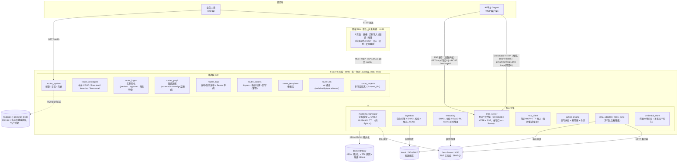
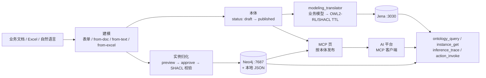

# 企业业务本体平台 · 系统架构说明

> 文档定位：面向研发与交付的系统级架构总览。接口字段级细节以 `docs/API-INTERFACE-DOC.md`（单一数据源）为准；设计与需求背景见 `proj_wiki/`。
>
> 最后更新：2026-10-22

---

## 1. 系统定位

企业业务本体平台（ontology_platform）是大模型 Agent 的**语义底座**：把企业业务流程建模为**可校验、可推理、可被 AI 直接调用**的本体（对象类型 + 属性 + 关系 + 实例），用以约束数据使用逻辑、降低模型幻觉。

服务两类用户：

| 用户 | 入口 | 做什么 |
|---|---|---|
| 业务人员 | 浏览器 SPA（无构建、零安装） | 表单化建模 / AI 生成 / 文档逆向 / 实例导入 / 图谱查看 / 推理 / 发布 MCP |
| AI 平台 / Agent | MCP 协议（over SSE） | 读取本体与实例、执行推理、回写动作（4 个标准工具） |

## 2. 技术栈与端口

| 层 | 技术 | 端口 | 说明 |
|---|---|---|---|
| 前端 | 原生 JS 单页应用（无构建） | **8123**（静态服务） | `frontend/index.html` + `app.js`，9 个功能页 |
| 后端 | Python FastAPI | **8000**（`0.0.0.0`，局域网可达） | 统一信封 `{success, data, error}`；Swagger `/docs`；JSON 行日志（LLM 请求/响应全量内容另落 `logs/llm/`） |
| RDF 存储 | Apache Jena Fuseki | **3030** | TTL 三元组 / SPARQL / 可选远程推理；不可达时降级文件模式 |
| 图数据库 | Neo4j Community | **7474**（HTTP）/ **7687**（Bolt） | 图谱可视化、路径查询；不可用时同步降级 JSONL |
| 关系库 | Postgres + pgvector | **5432**（DB `ont`） | **当前 MVP 仅用于健康检查**，数据目录 `deps/pgsql/data`；生产可承载 pgvector 检索 |
| 本地持久化 | 文件系统（JSON/JSONL/TTL） | — | `backend/data/`：项目/本体/实例/候选/模板 + TTL 快照 |

## 3. 总体架构图



**备用文本版**（无 Mermaid 渲染环境时）：

```text
 ┌────────────────────────────── 使用方 ──────────────────────────────┐
 │  业务人员（浏览器）                     AI 平台 / Agent（MCP 客户端）│
 └──────────┬─────────────────────────────────────┬───────────────────┘
            │ HTTP 页面                              │ MCP 双传输（Bearer token）
            │ 前端静态 :8123                         │ POST /mcp/{项目id}        ← Streamable HTTP(推荐)
            ▼                                        │ GET /mcp/{项目id}+.../messages/ ← SSE 兼容(旧客户端)
 ┌──────────────────────────────────────────────────────────────────────┐
 │              前端 SPA（index.html + app.js，无构建，:8123）             │
 │   建模 | 实例导入 | 图谱 | 推理 | 业务动作 | MCP | 日志 | 设置 | 使用教程 │
 └──────────────────────────────┬───────────────────────────────────────┘
                                │ REST /api/*（API_BASE 固定 :8000）
 ┌──────────────────────────────▼───────────────────────────────────────┐
 │              FastAPI 后端（main.py，0.0.0.0:8000）                    │
 │  统一信封 {success,data,error} · 分页 {items,total,page,page_size}     │
 │  /health · /docs(Swagger) · 异常处理器 · JSON 行日志(logs/)            │
 │                                                                      │
 │  api/ 路由层                                                          │
 │  ├ router_projects     多项目隔离（?project_id= 上下文）               │
 │  ├ router_ontologies   本体 CRUD + from-text/from-doc/from-excel      │
 │  ├ router_ingest       实例归化（preview→approve→候选审核）            │
 │  ├ router_graph        图谱数据（schema/knowledge 双模式）             │
 │  ├ router_mcp          发布/取消发布 + MCP Server 单例                 │
 │  ├ router_actions      Action dry-run→令牌→回写（幂等）                │
 │  ├ router_templates    模板库                                         │
 │  ├ router_llm          AI 通道（codebuddy/openai/none）               │
 │  └ router_system       健康/日志/凭据                                  │
 │                                                                      │
 │  核心引擎                                                             │
 │  ├ modeling_translator  业务模型 ↔ OWL2-RL/SHACL TTL（纯 Python）      │
 │  ├ ingestion            归化引擎（字段映射/LLM、SHACL 校验、候选 JSONL）│
 │  ├ reasoning            推理引擎（SHACL 校验 + OWL2-RL trace + 影响推理）│
 │  ├ mcp_server           MCP over SSE（每项目一 Server，4 个工具）       │
 │  ├ mcp_client           外部 MCP/HTTP 接入（探测/重试/鉴权）            │
 │  ├ action_engine        回写执行 + 幂等键 + 确认令牌                   │
 │  ├ jena_adapter         Fuseki HTTP 客户端（不可达降级文件模式）        │
 │  ├ neo4j_sync           Neo4j 同步（不可用降级 JSONL）                 │
 │  └ credential_store     凭据本地引用（不落库不打印）                    │
 └───────┬──────────────────┬──────────────────┬────────────────────────┘
         │ 3030 SPARQL      │ 7687 Bolt        │ 5432（仅探活）
         ▼                  ▼                  ▼
 ┌──────────────┐   ┌──────────────┐   ┌──────────────────┐
 │ Jena Fuseki  │   │   Neo4j      │   │ Postgres+pgvector│
 │ RDF 三元组库  │   │   图数据库    │   │ DB: ont（生产预留）│
 │ (TTL/推理)   │   │ (图谱/路径)   │   │ deps/pgsql/data  │
 └──────────────┘   └──────────────┘   └──────────────────┘
 后端本地持久化：backend/data/（JSON 项目/本体/实例/候选/模板 + TTL 快照 + 候选 JSONL）
```

## 4. 后端模块说明

| 模块 | 职责 | 要点 |
|---|---|---|
| `main.py` | 应用入口 | 路由挂载、`/health`、统一信封、异常处理器、MCP Server 挂载 |
| `api/` | 路由层 | 9 个 router（见架构图）；项目上下文统一走 `?project_id=` 查询参数 |
| `core/responses` | 信封与分页 | 列表必为 `{items, total, page, page_size}`；分页参数 `page`/`pageSize` |
| `core/storage` | JSON 持久化 | `JsonStore`，MVP 无需 Postgres 即可跑通；生产可替换 |
| `schemas/` | Pydantic 模型 | 与 API 文档逐字段对齐 |
| `modeling_translator/` | 建模翻译 | 业务层（对象/属性/关系）↔ OWL2-RL/SHACL TTL，纯 Python，VS1 核心 |
| `jena_adapter/` | RDF 客户端 | Fuseki HTTP 读写；不可达时优雅降级文件模式 |
| `ingestion/` | 实例归化 | LLM/字段映射 preview → approve → SHACL 校验 → 同步 Neo4j（降级 JSONL）；候选审核卡点 |
| `reasoning/` | 推理 | pyshacl 真实 SHACL 校验 + OWL2-RL 风格推理 trace + 业务影响推理 |
| `mcp_server/` | MCP 服务端 | 进程内单例 `get_mcp_server()`（router 与 main 共用）；每项目一个 SSE Server |
| `mcp_client/` | 外部接入 | HTTP transport 探测/重试/鉴权，读取映射生成候选（stdio 占位） |
| `action_engine/` | 动作执行 | dry-run → 确认令牌 → HTTP/MCP 真实回写 + 幂等键 + 日志 |
| `credential_store/` | 凭据 | 本地引用管理，不落库、不打印 |
| `template/` | 模板库 | 模板 CRUD + 内置模板 + 从模板实例化本体 |
| `viz/` | 可视化数据 | schema/knowledge 双模式图谱数据（TBox+ABox 合并） |
| `ai_helper/` | AI 通道 | codebuddy / openai / none 三通道统一适配 |
| `tests/` | pytest | 信封/分页规范、翻译器往返、本体 API、归化、图谱、模板/MCP/Action 等 |

## 5. 前端页面

| 页面 | 能力 |
|---|---|
| 建模 | 卡片式表单编辑对象/属性/关系（业务人员免 JSON）；AI 自然语言生成（`from-text`）；文档逆向抽取（`from-doc`：txt/md/docx/xlsx/pdf，异步 job + toast 进度）；Excel 导入（`from-excel` 约定表头）；本体编辑（PUT）/删除（DELETE 级联） |
| 实例导入 | 实例归化 preview → approve → 候选审核卡点 → 入库 |
| 图谱 | D3 渲染，本体视图 / 类树 / 知识图谱三 tab，TBox+ABox 合并，自然语言查询，外部归化来源着色 |
| 推理 | SHACL 校验与 OWL2-RL 推理 trace；两行式业务名下拉（实例/属性按业务名称选择，id 小字辅助）；影响推理 |
| 业务动作 | Action dry-run → 确认令牌 → 回写，幂等与日志 |
| MCP | 发布清单（**按单个本体发布/取消**）；ID 一键复制；按项目生成可一键复制的完整 MCP Server 配置；工具清单与调用示例 |
| 日志 | 后端 JSON 行日志查看 |
| 设置 | 项目切换、AI 通道配置等 |
| 使用教程 | 平台内嵌教程（`frontend/tutorial/`）：`manifest.json`（systemVersion + 教程 version/minor/updatedAt + chapters，章可带 `part` 字段分组）+ `chapters/<id>.md` + `assets/*.png` 截图；独立版本化（大版本随系统、内容更新涨 minor）；自研迷你 Markdown 渲染（标题/表格/代码块/图片/引用），左侧目录按 part 分组（快速开始/平台功能/典型案例）+ 前后章导航 |

## 6. 核心数据流



文字版链路：

1. **建模**：文档/Excel/自然语言 → 草稿本体（`status=draft`）→ 编辑后发布（`published`）
2. **翻译**：`modeling_translator` 把业务模型编译为 OWL2-RL/SHACL TTL 写入 Jena
3. **归化**：实例数据 preview（LLM/字段映射）→ 人工 approve → SHACL 校验 → 同步 Neo4j（不可用降级 JSONL），中间产物为候选 JSONL（审核卡点）
4. **使用**：图谱可视化、SHACL 推理校验、业务影响推理（推理页）
5. **输出**：MCP 页按本体发布 → AI 平台粘贴配置 → Agent 调用 4 个标准工具

## 7. MCP 接入

- **端点**（每项目独立，可同时发布互不影响；双传输并存，2026-10-28 修复）：
  - Streamable HTTP（推荐，2025-03-26/2025-06-18）：`POST /mcp/{项目id}`（单端点 JSON-RPC，`initialize` 回 `Mcp-Session-Id`）；`GET`（带 session 头开会话流）；`DELETE`（终止会话）
  - SSE 兼容（2024-11-05，旧客户端）：`GET /mcp/{项目id}`（`Accept: text/event-stream`）+ 消息端点 `POST /mcp/{项目id}/messages/`
  - 无 session 头的 Streamable `GET` 返回 405（与 SSE 兼容路径区分）
- **接入鉴权**：所有 `/mcp/{项目id}` 请求须带项目级 token（`Authorization: Bearer <token>` 或 `?token=`）；缺失/无效 401 `UNAUTHORIZED`。token 在 MCP 页「接入 token」生成/吊销（生成即轮换，旧值立即失效）
- **发布粒度**：单个本体；同一项目多个已发布本体共享端点（工具按 `ontology_id` 参数区分）；项目内无已发布本体时端点自动下线
- **发布状态**：落盘持久化（`data/projects/{项目id}/mcp_published.json`），后端重启自动恢复，**无需重新发布**；未发布项目连接 404 `NOT_PUBLISHED`，工具层对未发布 `ontology_id` 一律拒绝（`isError` + 错误码）
- **会话治理**：Streamable 会话空闲 30 分钟超时（过期 404，客户端重走 initialize）；内存端点上限 100 + 空闲 30 分钟回收（发布态在磁盘，回收无副作用）
- **工具**：`ontology_query` / `instance_get`（limit 默认 50/上限 200、offset 翻页、fields 投影）/ `inference_trace` / `action_invoke`（契约见 `docs/mcp_tools_contract.yaml`）；`ontology_id` 统一接受**本体名称或 32 位 ID**（名称解析，P0-1），`ontology_query` 留空 `ontology_id` 返回已发布本体清单；工具层错误区分 `NOT_FOUND`（本体不存在）/`NOT_PUBLISHED`（存在但未发布，附已发布清单）
- **本地 stdio 桥**：`backend/mcp_stdio_bridge.py` 供 WorkBuddy 本地模式注册（stdio 传输，自动读取项目 token 转发 `/mcp/{pid}`，工具语义与平台侧一致；项目 ID 经 `--project` 参数传入，换项目只改 mcp.json 的 args）；远程接入用方案 C 静态 token（`docs/MCP接入配置-方案C静态Token.md`）
- **运维端点传参**：`/api/mcp/server/{publish,unpublish,token,token/revoke}` 的 `project_id`/`ontology_id` 支持 query 参数或 JSON body 双形态（query 优先）
- **客户端配置示例**（端口固定 8000；AI 平台不在本机时把 `127.0.0.1` 换成运行平台机器的局域网 IP）：

```json
{
  "mcpServers": {
    "示例项目": {
      "type": "http",
      "url": "http://127.0.0.1:8000/mcp/<项目id>",
      "headers": { "Authorization": "Bearer <token>" }
    }
  }
}
```

> 旧客户端（仅支持 SSE）：`"type": "sse"`，token 拼在 URL 上 `http://127.0.0.1:8000/mcp/<项目id>?token=<token>`。
> 注意：前端静态端口（8123）不是后端，AI 平台配置**必须指向 8000**。

## 8. 关键设计决策

| 决策 | 说明 |
|---|---|
| 多项目隔离 | 所有 API 以 `?project_id=` 切换上下文；MCP 端点天然按项目独立 |
| 优雅降级 | Jena/Neo4j/PG 任一不可达后端仍可运行（`degraded`）：归化降级 JSONL、Jena 降级文件模式；最小启动只需前后端 |
| MCP 单例 | 进程内 `get_mcp_server()`，router 与 main 挂载共用，避免双实例导致发布状态不可见 |
| 动作安全 | 回写必须 dry-run + 确认令牌 + 幂等键；凭据只存本地引用（不落库不打印） |
| 审核卡点 | 实例归化必须人工 approve 才入库，候选 JSONL 可回溯 |
| 用户友好建模 | 业务人员零 JSON：表单 / AI 生成 / 文档逆向 / Excel 导入四条路径 |

## 9. 工程规范（script-check 规则 7）

- 所有接口返回统一信封 `{ success, data, error }`，**禁止裸数组/裸数据**
- 列表/分页 `data` 必为 `{ items, total, page, page_size }`；分页参数 `page`/`pageSize`，**禁止 `limit`**
- 字段命名 snake_case，时间戳 `created_at`/`updated_at`
- 任何对外 API 变更须同步 `docs/API-INTERFACE-DOC.md`（单一数据源）
- 回归：`cd backend && pytest -q`；全量 E2E `python scripts/e2e_regression_test.py`（34 项，含依赖可达性前置门禁）

## 10. 目录结构

```text
ontology_platform/
├── docs/
│   ├── 系统架构说明.md          # 本文档
│   ├── API-INTERFACE-DOC.md    # 接口设计单一数据源（强制同步）
│   ├── mcp_tools_contract.yaml # MCP 工具契约
│   ├── 业务人员使用流程说明.md
│   ├── naming-convention.md
│   └── storage-contract.md
├── frontend/                   # 无构建 SPA（index.html + app.js）
│   └── tutorial/               # 平台内嵌使用教程（manifest.json + chapters/*.md + assets/*.png）
├── backend/
│   ├── main.py                 # 入口（路由挂载、/health、信封、MCP 挂载）
│   ├── config.py / logging_setup.py
│   ├── core/                   # responses（信封/分页）、storage（JSON 持久化）
│   ├── schemas/                # Pydantic（与 API 文档逐字段对齐）
│   ├── api/                    # 9 个 router
│   ├── modeling_translator/    # 业务层 ↔ OWL2-RL/SHACL TTL（VS1 核心）
│   ├── jena_adapter/  neo4j_sync/  ingestion/  reasoning/
│   ├── mcp_server/  mcp_client/  action_engine/  credential_store/
│   ├── template/  viz/  ai_helper/  tests/
│   ├── data/                   # JSON/TTL/JSONL 持久化
│   └── logs/                   # JSON 行日志（app-*.log；llm/ 子目录存 LLM 请求/响应全量内容）
├── scripts/                    # setup-local-deps / start-all / start-deps /
│                               # restart_backend / e2e_regression_test 等
├── deploy/                     # Dockerfile（backend/frontend）、nginx
├── docker-compose.yml          # 交付封装：jena/neo4j/postgres/backend/frontend
└── proj_wiki/                  # 设计方案、PRD、操作日志（log.md）
```

## 11. 运行与部署

**本地（MVP 推荐）**

```powershell
# 一次性安装依赖（Java 17+ 检查、下载 Jena/Neo4j 到 deps/）
.\scripts\setup-local-deps.ps1

# 一键启动全部服务（依赖 + 后端 8000 + 前端 8123）
.\scripts\start-all.ps1
```

- 前端：http://localhost:8123
- 后端 API / Swagger：http://localhost:8000 / http://localhost:8000/docs
- 健康检查：http://localhost:8000/health
- 最小启动（无 SPARQL/图谱）：`cd backend && python main.py` + `cd frontend && python -m http.server 8123`（健康检查 `degraded` 属正常降级）
- 依赖门禁：`.\scripts\start-deps.ps1`（幂等拉起 Jena/Neo4j/PG 并校验可达性，E2E 前置）

**Docker（交付阶段）**

```bash
docker compose up -d
# 前端 http://localhost:8080   API http://localhost:8000/docs   Fuseki http://localhost:3030
```

## 12. 垂直切片进度

| 切片 | 状态 |
|---|---|
| VS0 运行基座（compose/health/日志/信封） | ✅ |
| VS1 建模闭环（创建/读取/导出/校验/快照 + 翻译器） | ✅ |
| VS2 推理校验（pyshacl SHACL + OWL2-RL trace） | ✅ |
| VS3 归化（LLM/映射 preview → SHACL → Neo4j，降级 JSONL） | ✅ |
| VS4 可视化（schema/knowledge 双 tab + D3） | ✅ |
| VS5 模板（CRUD + 内置模板 + 实例化） | ✅ |
| VS6 MCP Server（/mcp SSE + 4 工具自动生成） | ✅ |
| VS7 外部接入（HTTP 探测/重试/鉴权 + 映射候选） | ✅ |
| VS8 Action（dry-run → 令牌 → 回写 + 幂等） | ✅ |
| VS9 凭据（本地引用 + 状态接口） | ✅ |
| VS10 集成 | ✅（P0 全链路验收通过，见 `docs/VS10-集成验收报告.md`） |
